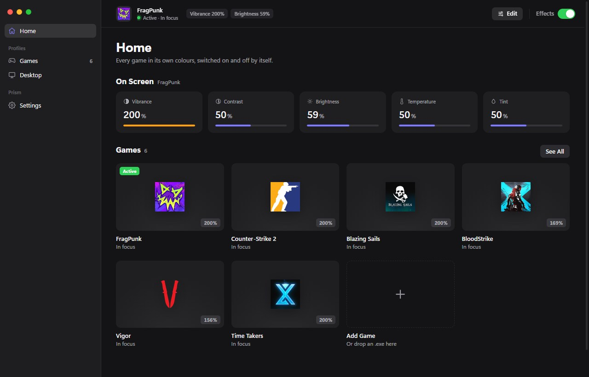
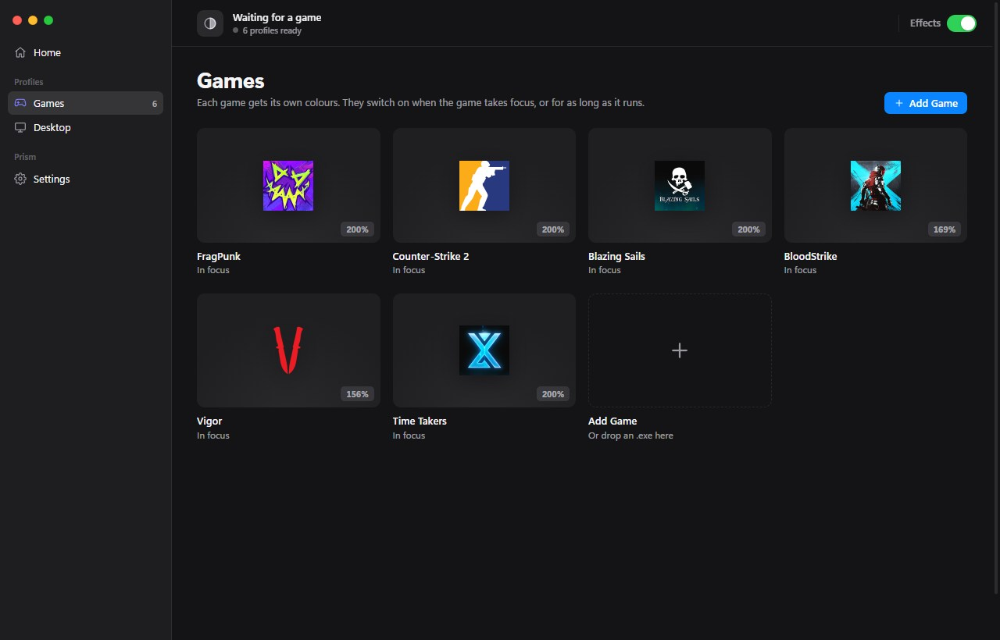
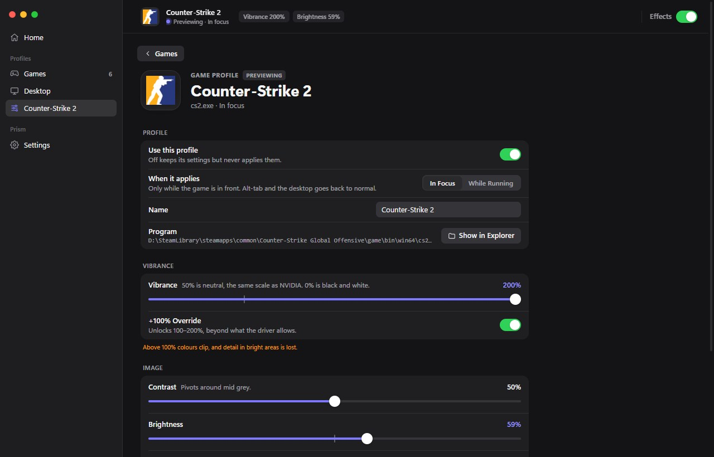

# Prism

Your games, in their own colours. A small native app for Windows 10 and 11, by PG.

**[Download the latest release](https://github.com/lilpatter/prism/releases/latest)**: `Prism_<version>_x64-setup.exe` installs it, `prism.exe` runs without installing.

More at [lilpatter.github.io/prism](https://lilpatter.github.io/prism/).

## What it does

- **A profile for every game.** Vibrance, contrast, brightness, temperature and tint. Add a game, or drop its `.exe` on the window, and set its look.
- **Switches by itself.** A profile comes on when its game takes focus and goes off when you alt-tab, or stays on for as long as the game runs.
- **Past the driver.** +100% Override takes vibrance to 200%, further than NVIDIA's or AMD's own settings go.
- **Live preview.** The profile you're editing is on screen as you drag.
- **Any graphics card.** NVIDIA, AMD and Intel alike. Prism doesn't touch driver settings and needs no admin rights.
- **Nothing injected.** No hooks, overlays or DLLs in your games, so it stays clear of anti-cheat.
- **Light in the tray.** Close the window and Prism keeps switching profiles from the tray using about 2 MB of memory.
- Coming from Digital Vibrance? Prism brings your profiles over on first run.

## Screenshots

  
  

## Good to know

- Exclusive fullscreen skips the Windows compositor, so colours don't reach it. Use borderless or windowed fullscreen.
- HDR changes the colour pipeline, so the effect may look different or not show at all.
- Windows Color Filters use the same feature and will fight with Prism. Keep them off.
- If Prism quits or is ended, Windows puts the colours back by itself.

## Requirements

Windows 10 or 11 and the WebView2 runtime, which ships with Windows 11.

Prism is a Windows app. There's no Mac version yet: the Mac-style sidebar and window buttons are just part of its design.

## Updates

Prism updates itself from this page's releases, also while it's in the tray, and checks each download against GitHub's SHA-256 digest. Turn it off under Settings › About.

## Credits

Made by [PG](https://lilpatter.github.io). Based on [Digital Vibrance](https://github.com/SYTStudio/DigitalVibrance) by SYTStudio.

Not affiliated with NVIDIA, AMD or Intel.

---

© 2026 PG. All rights reserved. Prism is free to download and use. Its source code is not public.
